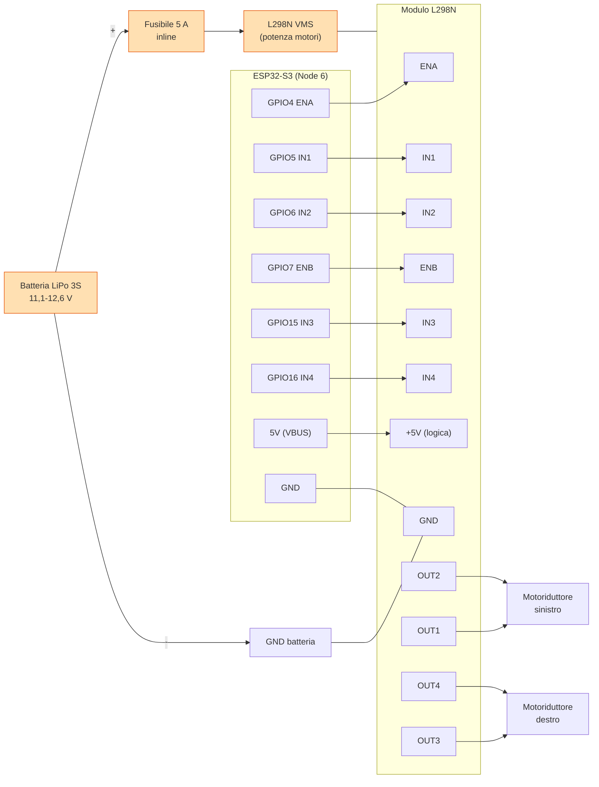

# OpenJ5 Node 6 — Cablaggio ESP32-S3 ↔ L298N (Cingoli)

> Schema di collegamento fisico del **Node 6 (Tracks)** secondo **ADR-019**: i due
> motoriduttori DC sono pilotati **dall'ESP32-S3**, non dal Raspberry Pi (che è
> solo cervello e non tocca mai il PWM).
> Mappa pin **approvata e autoritativa**: ADR-019 §3. Config sincronizzata:
> `config/node6_tracks/node.json` ↔ `firmware/node6_tracks/main/Kconfig.projbuild`
> (parità verificata dal test Node 6, T-032).
> Firmware: `firmware/node6_tracks/` (PlatformIO env `node6`).
> Ultimo aggiornamento: 2026-10-09

---

## 1. Materiale

| Componente | Note |
|------------|------|
| ESP32-S3 DevKitC-1 (o compatibile) | Nodo 6, WiFi nativo, logica 3,3 V |
| Modulo L298N dual H-bridge | Versione blu con heatsink e jumper ENA/ENB/5 V |
| 2× motoriduttore DC 12 V (XD-37GB520 300 rpm) | Uno sinistro, uno destro |
| Batteria LiPo 3S (11,1–12,6 V) o alimentatore 12 V ≥2 A | Potenza **solo** ai motori |
| Fusibile inline 5 A (consigliato) sul + batteria | Protezione cortocircuiti |
| Cavetti dupont + portafusibili | Segnali e massa |

> Encoder, IMU, ToF e bumper citati in §5 sono **previsti dalla mappa pin** ma
> **non ancora implementati nel firmware** (T-022): i pin sono già in config/Kconfig,
> il cablaggio è documentato qui per completezza.

---

## 2. Tabella pin ESP32-S3 → L298N (motori)

| Segnale L298N | GPIO ESP32-S3 | Funzione | Note |
|---------------|---------------|----------|------|
| **ENA** *(jumper rimosso)* | 4 | PWM motore sinistro | LEDC 1000 Hz / 10 bit |
| **IN1** | 5 | Direzione sinistro A | Livello logico |
| **IN2** | 6 | Direzione sinistro B | Livello logico |
| **ENB** *(jumper rimosso)* | 7 | PWM motore destro | LEDC 1000 Hz / 10 bit |
| **IN3** | 15 | Direzione destro A | Livello logico |
| **IN4** | 16 | Direzione destro B | Livello logico |
| **GND** | GND | Massa comune | ⚠️ obbligatoria (vedi §4) |
| **+5V** | 5V (VBUS) | Logica del modulo | Solo con jumper regolatore rimosso (vedi §4) |
| **VMS** | — | Potenza motori | Dal + batteria (via fusibile) |
| **OUT1 / OUT2** | — | Motore sinistro | Ai morsetti del motoriduttore |
| **OUT3 / OUT4** | — | Motore destro | Ai morsetti del motoriduttore |

⚠️ **Rimuovere i jumper ENA ed ENB**: li sostituiamo con i GPIO 4/7 per il
controllo di velocità PWM. Con i jumper montati l'abilitazione resta sempre HIGH
(velocità fissa, il PWM viene ignorato).

---

## 3. Diagramma dei collegamenti



> La **massa comune** (batteria − · GND L298N · GND ESP32-S3) è un solo nodo
> elettrico: senza di essa il PWM “galleggia” e il modulo non commuta.

---

## 4. Note elettriche

1. **HIGH 3,3 V vs livello L298N**: gli ingressi ENA/IN1..IN4 del L298N sono
   compatibili TTL e leggono HIGH a partire da ~2,3 V, quindi i 3,3 V
   dell'ESP32-S3 sono **accettati**. Un **level shifter è opzionale** (consigliato
   solo su tratte lunghe o moduli particolarmente insensibili).
2. **Jumper ENA/ENB rimossi** (obbligatorio): vedi §2.
3. **Jumper del regolatore 5 V rimosso**: con LiPo 3S piena (**12,6 V**) il
   regolatore 78M05 di bordo dissipa troppo; si **rimuove il jumper del 5 V** e si
   alimenta la logica del modulo dal **5 V dell'ESP32-S3** (pin VBUS) come in §3.
   Con alimentazione motori fissa a 12 V il jumper può restare montato e il filo
   del 5 V non serve (vedi KNOWLEDGE_BASE §1-ter).
4. **Massa comune obbligatoria**: batteria − ↔ GND L298N ↔ GND ESP32-S3. È la
   causa più frequente di riavvii/reset del modulo quando parte un motore.
5. **Fusibile inline** (5 A consigliato) sul positivo della batteria, prima di VMS.
6. **La batteria si collega PER ULTIMA**, a cablaggio completo (vedi §6).
7. **Non alimentare i motori dal 5 V dell'ESP32-S3**: la potenza arriva solo da
   VMS (batteria/alimentatore esterno).
8. **GPIO riservati ESP32-S3**: la mappa di ADR-019 usa solo pin sicuri (1–18, 21);
   evitare 19/20 (USB), 26–32 (flash), 33–37 (PSRAM), 43/44 (UART0) e gli
   strapping 0/3/45/46.

### 4.1 Scheda di verifica rapida (mappa ADR-019)

| Periferica | Pin GPIO | Stato firmware |
|------------|----------|----------------|
| ENA / IN1 / IN2 (sx) | 4 / 5 / 6 | ✅ implementato (bring-up motori) |
| ENB / IN3 / IN4 (dx) | 7 / 15 / 16 | ✅ implementato (bring-up motori) |
| Encoder sx A / B | 8 / 9 | ⛔ T-022 (non implementato) |
| Encoder dx A / B | 10 / 11 | ⛔ T-022 (non implementato) |
| I2C SDA / SCL (IMU + ToF) | 1 / 2 | ⛔ T-022 (non implementato) |
| ToF XSHUT ant. / post. | 12 / 13 | ⛔ T-022 (non implementato) |
| Bumper ant. | 14 / 17 | ⛔ T-022 (non implementato) |
| Bumper post. | 18 / 21 | ⛔ T-022 (non implementato) |

---

## 5. Periferiche future (T-022, non ancora nel firmware)

Pin già assegnati in `config/node6_tracks/node.json` e `Kconfig.projbuild`, ma
**nessun driver li usa ancora**: encoder, PID di velocità, odometria, IMU, ToF e
bumper sono lavoro di **T-022**.

### 5.1 Encoder in quadratura (ruote)

| Encoder | Canale A | Canale B | PPR |
|---------|----------|----------|-----|
| Sinistro | GPIO 8 | GPIO 9 | 1024 |
| Destro | GPIO 10 | GPIO 11 | 1024 |

Il destro è configurato `inverted: true` (simmetria meccanica). Servono ingressi
con interrupt per la lettura in quadratura.

### 5.2 Bus I2C condiviso (IMU + ToF)

| Segnale | GPIO |
|---------|------|
| SDA | 1 |
| SCL | 2 |

- **MPU6050** (IMU): indirizzo I2C **0x68** (`address: 104`), fusione Madgwick,
  200 Hz.
- **VL53L0X** (2× ToF): indirizzi **0x29** (`address: 41`, anteriore) e **0x30**
  (`address: 48`, posteriore), separati via pin XSHUT.

### 5.3 ToF XSHUT e bumper

| Segnale | GPIO | Note |
|---------|------|------|
| ToF XSHUT anteriore | 12 | Riassegnazione indirizzo VL53L0X |
| ToF XSHUT posteriore | 13 | Riassegnazione indirizzo VL53L0X |
| Bumper anteriore | 14, 17 | Ingresso collisione (IR) |
| Bumper posteriore | 18, 21 | Ingresso collisione (IR) |

---

## 6. Procedura di bring-up (banco)

1. **Cablaggio** seguendo §2 e §3, **a robot spento**. Verificare con un tester la
   continuità della massa comune (batteria − ↔ GND L298N ↔ GND ESP32-S3).
2. **Checklist pre-test**:
   - jumper ENA/ENB rimossi ✅
   - jumper regolatore 5 V rimosso (con LiPo 3S piena) ✅
   - **ruote sollevate da terra** ✅
   - fusibile inline inserito ✅
3. **Config locale credenziali** (mai committata):
   ```bash
   cd firmware/node6_tracks
   cp sdkconfig.local.example sdkconfig.local   # WiFi/MQTT
   ```
4. **Build + flash** (VSCode + PlatformIO, stessi file del progetto ESP-IDF):
   ```bash
   cd firmware/node6_tracks
   pio run -e node6                 # build (prima volta scarica IDF v5.5, ~1 GB)
   pio run -e node6 -t upload       # flash (porta autodetect)
   pio device monitor               # log su UART0, 115200
   ```
   In alternativa `idf.py set-target esp32s3 && idf.py -p PORT flash monitor`.
5. **Collega la batteria PER ULTIMA** (motori già cablati).
6. **Verifica sulla UART**: all'avvio i motori restano **rilasciati** (PWM 0) finché
   non arriva un comando; lo stato è pubblicato su `openj5/v1/tracks/state`.
7. **Comandi MQTT di prova** (topic `openj5/v1/tracks/cmd`):
   ```bash
   mosquitto_pub -h <broker> -t openj5/v1/tracks/cmd -m '{"cmd":"forward","velocity":0.3}'
   mosquitto_pub -h <broker> -t openj5/v1/tracks/cmd -m '{"cmd":"stop"}'
   mosquitto_pub -h <broker> -t openj5/v1/tracks/cmd -m '{"cmd":"backward","velocity":0.3}'
   mosquitto_pub -h <broker> -t openj5/v1/tracks/cmd -m '{"cmd":"spin_left","velocity":0.3}'
   mosquitto_pub -h <broker> -t openj5/v1/tracks/cmd -m '{"cmd":"spin_right","velocity":0.3}'
   ```
   Verificare che i due motori girino nel senso atteso in ogni fase e che la
   velocità vari col campo `velocity` (normalizzato `[-1, +1]`, default 0.3).
   Un motore che gira al contrario: inverti i suoi DUE fili su OUTx (oppure
   `inverted` in config, T-022).
8. **Watchdog**: a comandi fermi mentre si marcia, dopo **1000 ms** il nodo esegue
   uno **short-brake** e va in fault (`.../state` → `error`); un nuovo comando
   ripristina da `error`. La perdita del link MQTT porta allo stesso fail-safe.
   L'**E-stop di sistema** su `openj5/v1/system/emergency_stop` ferma subito il nodo.
9. **Fine sessione**: comando `stop`, **stacca la batteria**, scollega l'ESP32-S3.
   LiPo fermo a lungo → riportarlo a *storage* (~11,4 V).

---

## 7. Troubleshooting rapido

| Sintomo | Causa / cura |
|---------|--------------|
| Un motore gira al contrario | Inverti i suoi DUE fili su OUTx (o `inverted` in config) |
| Velocità fissa, ignora `velocity` | Jumper ENA/ENB ancora montati |
| L'ESP32-S3 si riavvia quando parte il motore | Massa comune assente o potenza presa dall'USB |
| Il motore non gira (PWM 0) | Nessun comando / watchdog scaduto / nodo in `error` |
| Build “Detected size(4096k) smaller than …(8192k)” | Board da 4 MB: `board_upload.flash_size = 4MB` (già in `platformio.ini`) |

---

*Rispetta ADR-019 (tutti i nodi ESP32-S3; Pi solo cervello), ADR-005 (HAL),
ADR-008 (zero numeri magici: i pin vivono in `config/node6_tracks/node.json` e
`Kconfig.projbuild`) e ADR-018 (port `IMotorDriver`). Il vecchio percorso
Pi→GPIO→L298N è **ritirato** (v. `BENCH_TRACKS.md`).*
